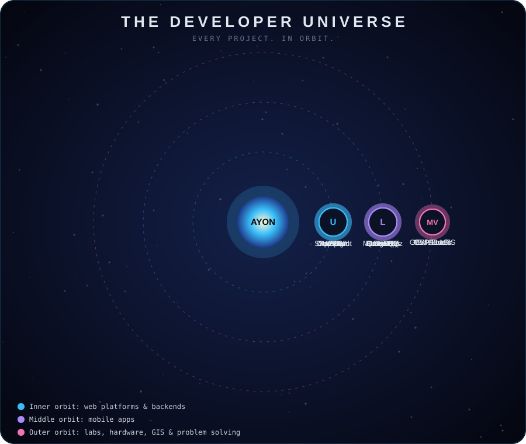
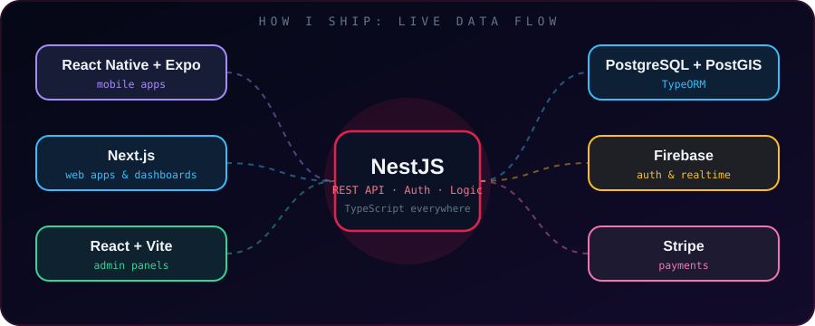

<div align="center">



<br/>

<a href="https://ayon7544.github.io"></a>
<a href="https://www.linkedin.com/in/YOUR-LINKEDIN"></a>
<a href="https://codeforces.com/profile/Ayon%20Ghosh%2002"></a>


<br/><br/>


</div>

<br/>

## 🧬 `whoami`

```ts
// ayon.config.ts
export const ayon = {
  name: "Ayon Ghosh",
  role: "Full-Stack Engineer",
  base: "Dhaka, Bangladesh 🇧🇩  →  working remotely with the world",
  education: "BSc Computer Science, University of Asia Pacific",
  experience: "3+ years shipping web & mobile products",

  backend: ["NestJS", "Node.js", "TypeORM", "PostgreSQL"],
  web:     ["Next.js", "React", "Vite", "TypeScript", "Tailwind CSS"],
  mobile:  ["React Native", "Expo Router", "NativeWind", "RTK Query", "Reanimated", "Firebase"],

  hobbies: ["ESP32 & IoT tinkering", "Competitive programming", "Product ideas"],
  nextLevel: "AI Systems Engineer",
  hiring: true,   // open to remote + enterprise roles
} as const;
```

<br/>

<div align="center">

## 🪐 The Developer Universe

*Every product I've built, orbiting one engineer.*



</div>

<br/>

<div align="center">

## ⚡ How I Ship

*One TypeScript backbone. Any client. Any data store.*



</div>

<br/>

## 🗄️ The Project Vault

*Pulled live from my GitHub repos. Click any block to open it.*

<!--PROJECTS:START-->
<details open>
<summary><b>🌐 Web platforms & backends</b></summary>
<br/>

| Project | What it does | Stack |
|---|---|---|
| 🎓 **EMS** | Education Management System, a full school-management platform with admin panel | NestJS, Next.js, PostgreSQL |
| 🏪 **Shop Management System** | Enterprise shop/market management with a single-admin dashboard for utilities and shop records | Next.js, NestJS, PostgreSQL |
| 🏫 **Aula360 / ALUA Academy Admin** | Admin web panel wired to a real backend through its OpenAPI spec | React, Vite |
| 🛒 **SwiftCart** | E-commerce platform with Stripe checkout | Next.js, NestJS, Stripe |
| 🩺 **pG65** | Healthcare platform | NestJS, React |
| 🧩 **DevBoard** | Developer dashboard | Full stack |
| 🌐 **Utopia** | Community platform | Full stack |

</details>

<details open>
<summary><b>📱 Mobile apps</b></summary>
<br/>

| Project | What it does | Stack |
|---|---|---|
| 🏠 **HouseOps** | Housing platform connecting military members, landlords and partners | React Native, Expo Router |
| 👟 **GOSNKR** | Sneaker reseller marketplace | React Native + backend APIs |
| 🌙 **Strive** (Itminan) | Islamic habit tracker with smooth animations | Expo, NativeWind, RTK Query, Reanimated |
| 💰 **Budget IQ** | Personal finance app, live on Google Play | React Native, Firebase |
| 📚 **Matura Quiz App** | Exam-prep app with a test archive, quizzes and extra practice flows | React Native, Expo |
| 🧠 **Quiz Prep** | Quiz and exam practice mobile app | React Native |
| 🧭 **Life OS** | Personal life-management app: finance, productivity, time and career in one place *(in progress)* | React Native |

</details>

<details>
<summary><b>🔬 Labs, hardware & fields</b></summary>
<br/>

| Area | What I do |
|---|---|
| ⚡ **ESP32 / IoT** | DIY electronics and connected-device experiments |
| 🌍 **GIS & PostGIS** | Spatial data and mapping work, including at Dhaka WASA |
| 🏁 **Competitive programming** | 345+ problems solved on Codeforces |
| 🚀 **MVP building** | Rapid full-stack prototypes for early-stage products |

</details>

<br/>
<!--PROJECTS:END-->

### 🔥 Recently shipped

<!--RECENT:START-->
- Syncing with GitHub on the next run...
<!--RECENT:END-->

<br/>

## 🛰️ Mission Log

| Period | Mission |
|---|---|
| **Aug 2025 → now** | Full-Stack Developer, remote |
| **2024 → now** | Freelance Full-Stack Developer, building products for clients |
| **Jan – Jun 2025** | Full-Stack Developer at **Eutropia IT**, building MVPs |
| **Mar – May 2025** | Full-stack work at **Dhaka WASA** with spatial data |
| **Jun 2021 – Jul 2025** | BSc in Computer Science, **University of Asia Pacific** |

<br/>

<div align="center">

## 📡 Live Telemetry

*These panels refresh on their own.*


<br/>

### 🐍 The snake is eating my commits

<picture>
  <source media="(prefers-color-scheme: dark)" srcset="https://raw.githubusercontent.com/ayon7544/ayon7544/output/github-snake-dark.svg" />
  <source media="(prefers-color-scheme: light)" srcset="https://raw.githubusercontent.com/ayon7544/ayon7544/output/github-snake.svg" />
  
</picture>

<br/>


<br/><br/>


<br/>

## 🤝 Let's build something

I'm open to **remote** and **enterprise** full-stack roles, and to interesting collaborations.

<a href="https://ayon7544.github.io"></a>


</div>
